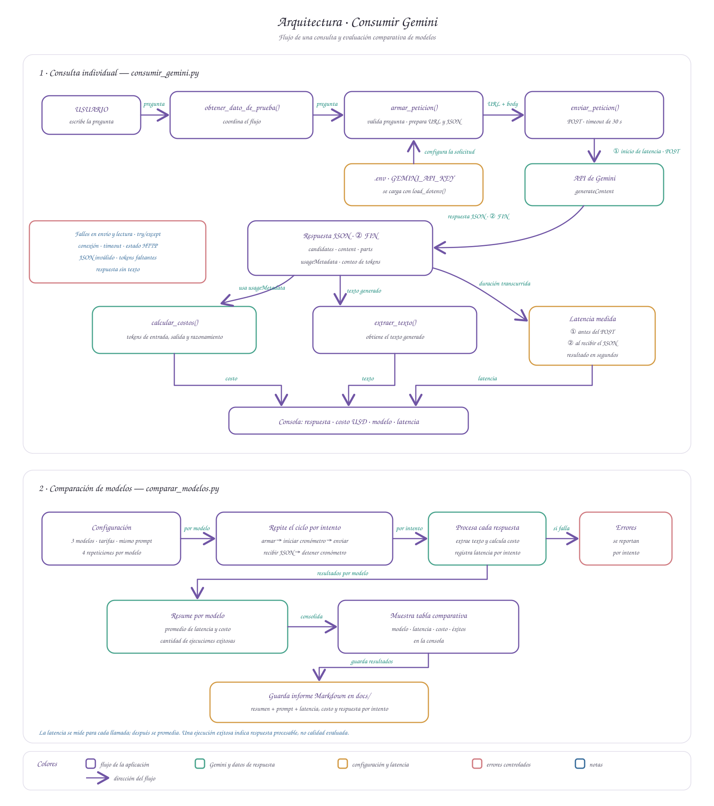

# Decisión de arquitectura: elección de modelo

**Fecha de la comparación más reciente:** 22 de octubre de 2026  
**Miniaplicación:** RhythmMentor

**Perfil de egreso declarado:** Backend / Integración de APIs.

## Modelo elegido

**Gemini 3.5 Flash-Lite (`gemini-3.5-flash-lite`), como elección provisional.** En la comparativa más reciente fue el único modelo que obtuvo 4 de 4 respuestas procesables para cada uno de los dos prompts. La calidad de las respuestas todavía no se ha evaluado con una rúbrica, por lo que esta elección se basa en consistencia, latencia y costo observado, no en una puntuación de calidad.

## Contexto y requisitos de la miniaplicación

RhythmMentor busca ayudar a personas que aprenden instrumentos musicales de forma autodidacta a organizar sus prácticas y mantener una progresión adecuada. El proyecto comienza con sesiones de batería para principiantes, generadas a partir de objetivos, tiempo disponible, ejercicios y registros de progreso.

Para el **Gate 1**, el alcance comprometido es consumir la API del modelo, procesar su respuesta y manejar errores sin fallos inesperados. En concreto, se consideran errores de conexión, timeout, estado HTTP, JSON inválido y respuestas sin texto o con datos faltantes. La recuperación de material educativo y el uso del historial se plantean para Gate 2; la API con FastAPI y la ejecución reproducible con Docker, para Gate 3. La comparativa actual prueba generación de sesiones y adaptación a una dificultad descrita en el prompt; todavía no prueba RAG ni una conexión real al historial de práctica.

Requisitos considerados en los prompts de esta comparación:

- Generar una práctica para una persona principiante en batería electrónica, con instrucciones y objetivos.
- Respetar la duración total solicitada: 20 minutos en el primer prompt y 12 minutos en el segundo.
- En el segundo prompt, aumentar gradualmente la dificultad y recomendar cómo evitar tensión o dolor.

## Diagrama de arquitectura

El diagrama muestra la consulta individual, la medición de latencia por llamada y la comparación de modelos, que guarda sus resultados y respuestas en Markdown.

## Comparación de candidatos

La comparativa más reciente usó los mismos dos prompts en cada modelo y cuatro repeticiones por prompt. El [informe completo de la comparación](./comparativa_modelos_2026-10-22_20-17-56.md) incluye las preguntas y cada respuesta. Las latencias y los costos promedio de la tabla corresponden a intentos procesados correctamente; los errores no tuvieron datos de uso con los que calcular un costo.

| Prompt | Modelo | Entrada por millón de tokens (USD) | Salida por millón de tokens (USD) | Latencia promedio (s) | Costo promedio estimado (USD) | Respuestas procesables |
| --- | --- | ---: | ---: | ---: | ---: | ---: |
| Sesión de coordinación, 20 min | Gemini 3.8 Flash | 0,75 | 3,75 | — | — | 0/4 |
| Sesión de coordinación, 20 min | Gemini 3.6 Flash | 0,75 | 3,75 | 18,09 | 0,01048350 | 1/4 |
| Sesión de coordinación, 20 min | **Gemini 3.5 Flash-Lite** | **0,30** | **2,50** | **5,61** | **0,00324240** | **4/4** |
| Sesión de coordinación, 20 min | Gemini 3.1 Flash-Lite | 0,25 | 1,50 | 5,90 | 0,00137125 | 2/4 |
| Adaptación al progreso, 12 min | Gemini 3.8 Flash | 0,75 | 3,75 | — | — | 0/4 |
| Adaptación al progreso, 12 min | Gemini 3.6 Flash | 0,75 | 3,75 | 16,69 | 0,01020525 | 1/4 |
| Adaptación al progreso, 12 min | **Gemini 3.5 Flash-Lite** | **0,30** | **2,50** | **4,44** | **0,00223148** | **4/4** |
| Adaptación al progreso, 12 min | Gemini 3.1 Flash-Lite | 0,25 | 1,50 | 10,56 | 0,00118725 | 3/4 |

Las tarifas indicadas son las tarifas estándar pagadas consultadas para la comparación; pueden cambiar. La [página oficial de precios de Gemini API](https://ai.google.dev/gemini-api/docs/pricing) lista actualmente esos valores para estos modelos.

**Observación sobre las pruebas:** Gemini 3.8 Flash registró timeouts y respuestas HTTP 503 en sus ocho intentos. Gemini 3.6 Flash tuvo errores HTTP 503 y 429; Gemini 3.1 Flash-Lite también presentó timeouts y 503. Estos resultados describen esta ejecución y no permiten concluir que la causa sea la calidad del modelo.

**Calidad de las respuestas:** No evaluada; próxima a evaluar.  
**Resultado de calidad / rúbrica aplicada:** ______________________________  
**Cumplimiento exacto de duración verificado automáticamente:** No evaluado.

“Respuesta procesable” significa que el programa recibió y extrajo el texto y pudo estimar su costo. No significa que la rutina sea musicalmente adecuada, segura o que cumpla exactamente la duración solicitada.

## Justificación

Elijo Gemini 3.5 Flash-Lite porque fue consistente en los dos escenarios: tuvo 4/4 respuestas procesables para cada prompt, con promedios de 5,61 y 4,44 segundos. En estos intentos también presentó costos promedio estimados menores que Gemini 3.6 Flash y latencias similares o menores que Gemini 3.1 Flash-Lite. El criterio principal de esta decisión es la consistencia observada, junto con un equilibrio favorable entre latencia y costo.

La decisión sigue siendo provisional: se basa en cuatro intentos por prompt y no incluye una evaluación de calidad. En la próxima evaluación falta puntuar, con una rúbrica, si cada plan responde al objetivo, progresa de forma apropiada, evita recomendaciones riesgosas y suma exactamente los minutos solicitados. También conviene repetir la prueba de Gemini 3.8 Flash para comprobar su disponibilidad después de los timeouts y errores HTTP 503 observados.

## Alternativa descartada y por qué

- **Gemini 3.8 Flash:** no obtuvo respuestas procesables en esta ejecución (0/4 por prompt). Se deja pendiente de repetir la prueba porque se observaron timeouts y HTTP 503; no se descarta por calidad.
- **Gemini 3.6 Flash:** obtuvo 1/4 respuestas procesables en cada prompt, con costos promedio estimados mayores que Gemini 3.5 Flash-Lite en los intentos exitosos. No mostró una ventaja de calidad medida.
- **Gemini 3.1 Flash-Lite:** fue más económico y alcanzó 2/4 y 3/4 respuestas procesables. Por ahora, su menor consistencia observada pesa más que su costo menor; se podría reevaluar con más repeticiones.
